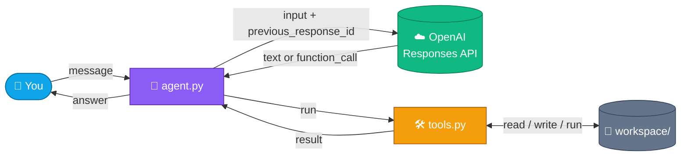
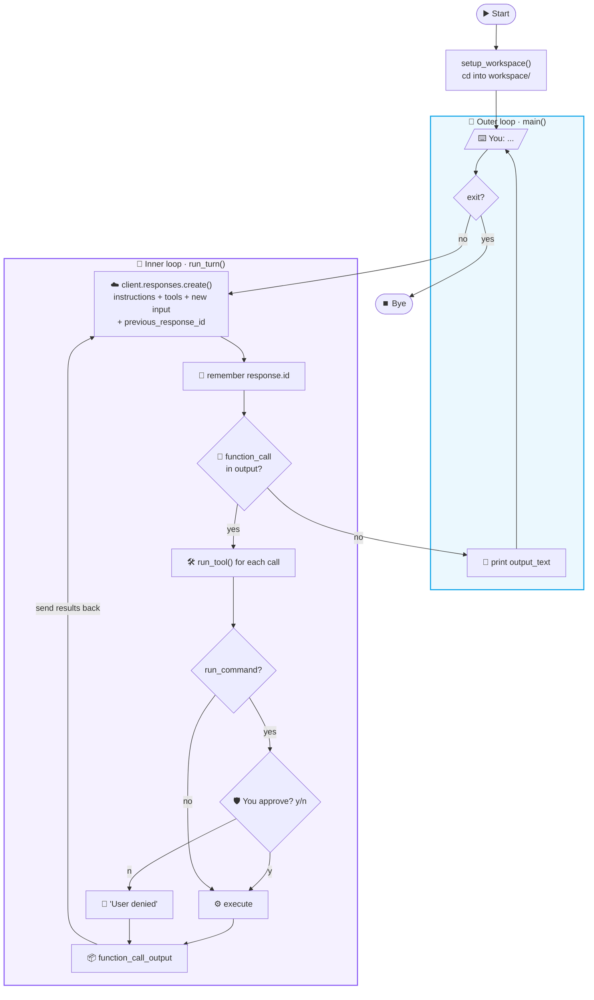
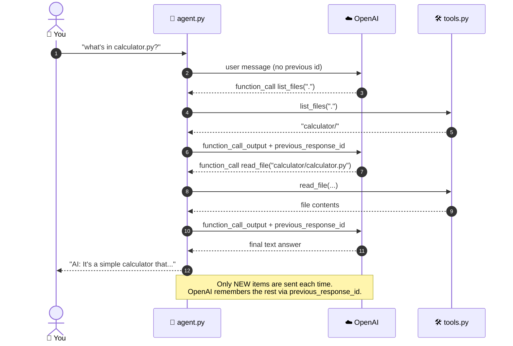
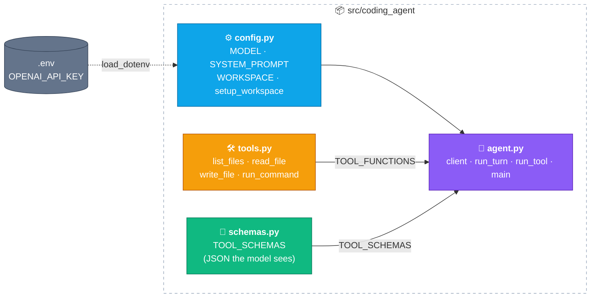

<div align="center">

# 🤖 Coding Agent

**A minimal AI coding agent built from scratch in Python.**
It chats in your terminal, explores files, writes code and runs commands,
powered by the OpenAI **Responses API** with tool calling.


</div>

---

## ✨ Features

| | Feature | Description |
|---|---|---|
| 💬 | **Chat loop** | Talk to the agent in your terminal |
| 🛠️ | **Tool calling** | The model decides when to list, read, write or run |
| 🔁 | **Agent loop** | Chains several tool calls before answering |
| 🧠 | **Server-side memory** | Conversation is kept by OpenAI via `previous_response_id` |
| 🩹 | **Error recovery** | Tool errors go back to the model instead of crashing |
| 🛡️ | **Human approval** | Every shell command needs your `y/n` |
| 📁 | **Sandbox folder** | Everything the agent builds lands in `workspace/` |

---

## 🗺️ How it works

### The big picture



### The agent loop

Two loops are nested inside each other. The **outer loop** (`main`) waits for you.
The **inner loop** (`run_turn`) keeps calling the model until it stops asking for tools.



### One turn, step by step

A real example: *"what's in calculator.py?"*



### Module map



> [!TIP]
> **schemas.py** describes the tools *to the model*, and **tools.py** *is* the tools.
> The names must match: when the model calls `read_file`, the agent finds
> `TOOL_FUNCTIONS["read_file"]` and runs it.

---

## 🛠️ Tools

| Tool | What it does | Needs approval |
|---|---|:---:|
| `list_files` | Lists files and folders (folders end with `/`) | ❌ |
| `read_file` | Reads a text file | ❌ |
| `write_file` | Creates or overwrites a file | ❌ |
| `run_command` | Runs a shell command (30 s timeout) | ✅ |

---

## 🚀 Getting started

### Requirements

- Python **3.13+**
- [uv](https://docs.astral.sh/uv/) (recommended) or pip
- An OpenAI API key

### Setup

```bash
# 1. Install dependencies
uv sync                          # or: pip install -r requirement.txt

# 2. Add your API key
copy .env.example .env           # then edit OPENAI_API_KEY in .env
```

### Run

```bash
uv run src/coding_agent/agent.py
```

### Example session

```text
You: make a folder called ken
[tool] run_command({'command': 'mkdir ken'})
Run this command? `mkdir ken` (y/n): y
AI: Created folder "ken".

You: exit
```

---

## 📂 Project structure

```text
Coding_Agent/
├── src/coding_agent/
│   ├── agent.py        🤖 OpenAI client + agent loops
│   ├── config.py       ⚙️ model, system prompt, workspace path
│   ├── tools.py        🛠️ the Python functions the agent can call
│   └── schemas.py      📜 tool descriptions sent to the model
├── workspace/          📁 projects created by the agent (not committed)
├── .env                🔑 your API key (not committed)
├── .env.example
├── pyproject.toml
└── requirement.txt
```

---

## ⚠️ Safety notes

> [!WARNING]
> This is a learning project, **not a sandbox**. Read every command before typing `y`.

- `write_file` **overwrites files without asking**.
- `run_command` asks for approval, but runs anything you approve.
- `workspace/` keeps things tidy, but the agent can still reach other paths (e.g. `..` or absolute paths).
- Conversations are stored on OpenAI's servers (`store=True` is the default) so that `previous_response_id` works.

---

## 🧭 Roadmap

- [x] Tool calling with an agent loop
- [x] Migrate to the Responses API with server-side conversation state
- [x] Split into `config` / `tools` / `schemas` / `agent` modules
- [ ] `edit_file` tool (replace a snippet instead of rewriting the whole file)
- [ ] Limit file tools to paths inside `workspace/`
- [ ] Stream the model's responses
- [ ] Max-iteration guard and API retry with backoff
- [ ] Tests with `pytest`
